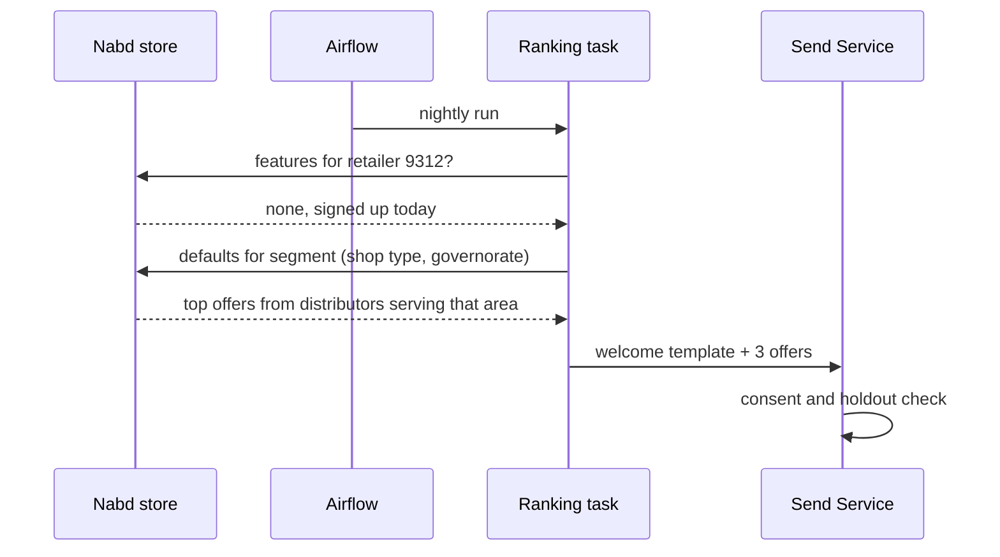
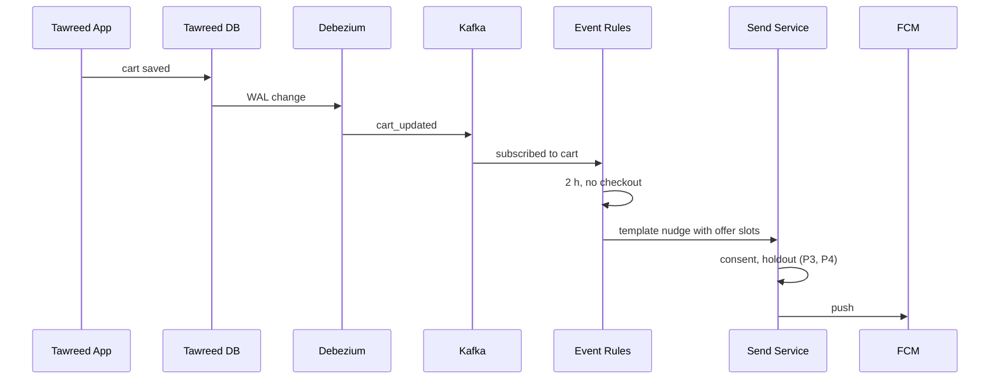
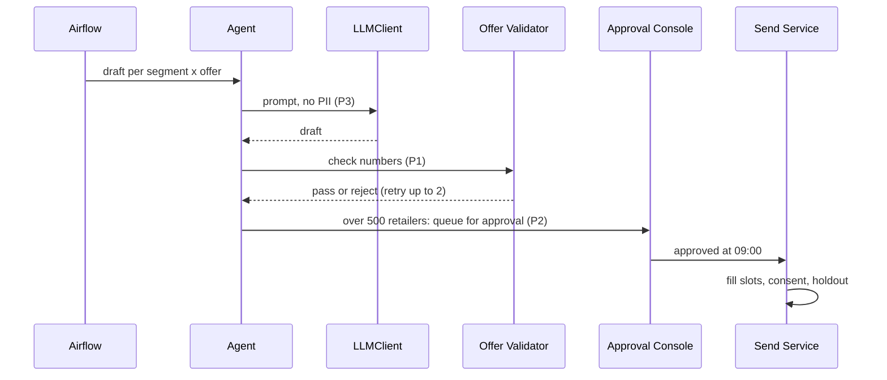

# Nabd · Software Design Document

**Session 2 · building blocks · Ismail Mohamed · v1 · 2026-10-26**

This document follows the course SDD template: intro and facts, then one section per viewpoint.
The principles (P1–P4), goals (G1–G4) and the ARB checklist from Session 1 still apply; see the
[governance pack](01-governance-pack.md). Decisions are recorded in [`/adr`](../adr/).

**Diagrams.** Context view: [`01-governance-architecture.drawio`](../diagrams/src/01-governance-architecture.drawio).
Data and deployment view: [`02-data-deployment.drawio`](../diagrams/src/02-data-deployment.drawio)
(its PNG is exported by CI on merge).

---

## 1. Problem and pain points

- **Every retailer gets the same offers.** Distributors publish offers and marketing pushes them
  to everyone. Relevance is low, and so is trust (G2).
- **Next best action.** Retailers who abandon a cart or slow down before churning get nothing,
  or a generic blast days later.
- **New retailers (cold start).** A retailer who signed up yesterday has no orders, so nothing
  personal can be said about them yet.
- **Campaign drafting by hand.** Marketing writes every push in Egyptian Arabic by hand. An agent
  can draft it, as long as a person still approves what goes out at scale (P2).

## 2. Goals and non-goals

Goals are G1–G4 in the [README](../README.md): repeat orders +15% against a holdout,
CSAT 60% → 80% with opt-outs under 1%, cost per incremental order −25%, and zero unapproved
prices under PDPL.

Non-goals for v1:

- WhatsApp or SMS. Push only.
- A real-time ML model per event ([ADR-0002](../adr/0002-nba-batch-vs-realtime.md)).
- One LLM draft per retailer. Drafts are per segment × offer; names and prices go into template
  slots.
- Ranking the home page inside the Tawreed app. Nabd decides what to push, not what the app shows.

## 3. As-is

Tawreed today: the mobile app and the dashboard talk to the Tawreed backend, which writes to one
operational Postgres database. Distributors publish offers in the dashboard. Marketing sends
push notifications from the same dashboard, to everyone or to a hand-picked list. There is no
segmentation, no holdout, and no record of which push led to which order.

## 4. Assumptions

Not verified yet. Each one has a question for the next round with Tawreed.

| Assumption | Value | Why it matters |
| --- | --- | --- |
| Active retailers | ~20,000 | Size of the nightly scoring run |
| Distributors | ~150 | Offers per night, approval load |
| Concurrent dashboard users (Nabd screens) | ~30 normal, ~80 at Ramadan and Eid peaks | Sizing the Approval Console |
| Cart and order events | ~400k per day, peaks of ~50 per second in the evening | Kafka and Event Rules sizing |
| Nightly window | 00:00–06:00, approvals open at 09:00 | The pipeline has to finish inside it |
| Push opt-in | ~70% of retailers | Reach of every campaign |

## 5. Principles and key decisions

P1–P4 from Session 1 still lead. Session 2 adds three platform rules:

- **Data stays in-country, at rest and in transit.** The only exceptions are vendors under a DPA
  that never receive PII (P3): the LLM API and FCM.
- **Internal services sit behind the VPN.** The only public entry is Tawreed's API gateway, over
  HTTPS with a JWT. Inside the VPN, services may talk plain HTTP.
- **Nabd never queries Tawreed's operational database.** It reads changes through CDC.

| ADR | Decision |
| --- | --- |
| [0001](../adr/0001-llm-hosting.md) | LLM API behind `LLMClient`; amended with a same-model fallback provider and a different judge model |
| [0002](../adr/0002-nba-batch-vs-realtime.md) | Nightly batch plus near-real-time rules |
| [0003](../adr/0003-vector-store.md) | pgvector behind `VectorStore`; amended: lives in Nabd's own store, Qdrant considered |
| [0004](../adr/0004-own-analytical-store.md) | Own analytical store fed by CDC (Debezium → Kafka) |

## 6. Context viewpoint

Unchanged from Session 1: retailers, distributors and marketers use Tawreed's app and dashboard;
Nabd sits behind them and talks to two vendors, the LLM API and FCM. What Session 2 adds is
inside the box, in the next sections.

## 7. Components

| Component | Job | Inside |
| --- | --- | --- |
| Debezium + Kafka | Moves order, cart, offer and consent changes out of Tawreed's database | One topic per table, one data contract per topic |
| Nabd store (Postgres) | Everything Nabd knows about a retailer, plus features and vectors | CDP tables, feature tables, pgvector |
| Airflow | Runs the nightly pipeline in order, with retries, and stops it when a step fails | One DAG, six tasks (section 9.2) |
| Event Rules | Reacts to cart and stock events within minutes | Kafka consumer, timers, pre-approved templates |
| Agent Orchestrator | Drafts copy for each segment × offer | Planner, retrieval, prompt builder, validator gate |
| `LLMClient` | The only component that calls an LLM | PII tokenization, cost logging, circuit breaker, fallback |
| Offer Validator | Rejects any draft whose numbers don't match its offer (P1) | Deterministic code, no model |
| Approval Console | Marketer approval above 500 retailers, kill switch (P2) | Web API behind the gateway |
| Send Service | Consent check, holdout assignment, push (P3, P4) | FCM client, outbox table |

## 8. Deployment viewpoint

Everything runs on Kubernetes in an in-country region. The first sizing below is a starting
point for the load test, not a promise.

| Service | Pods | Request → limit | Scaling |
| --- | --- | --- | --- |
| Approval Console API | 2 | 1 vCPU / 2 GiB → 2 vCPU / 4 GiB | HPA at 70% CPU |
| Send Service | 2 | 0.5 vCPU / 1 GiB → 1 vCPU / 2 GiB | HPA on outbox length |
| Event Rules | 2 | 0.5 vCPU / 1 GiB → 1 vCPU / 2 GiB | One pod per Kafka partition, up to 6 |
| Airflow workers | per task | 1 vCPU / 2 GiB → 4 vCPU / 8 GiB | Parallel tasks, rate-limited for the LLM |
| Nabd store (Postgres) | primary + replica | sized by load test | Vertical; the replica serves the console |
| Kafka | 3 brokers (managed if in-country) | vendor sizing | Partitions |

- **No GPUs.** The models are classical and run on CPU; the LLM and embeddings come from an API
  ([ADR-0001](../adr/0001-llm-hosting.md)). GPUs come back into the plan only if we self-host.
- **Two pods minimum** for anything on the send path, so one crash doesn't stop delivery.
- **Peaks.** Ramadan and Eid move the evening peak later and higher. HPA covers the API and the
  rules; the nightly window is checked against peak-season data before Ramadan.
- **Disaster recovery.** This is Tawreed's call, not Nabd's. If Tawreed runs a second region,
  Nabd goes active-passive there: the store replicates, services stay scaled to zero until
  failover. If not, pods spread across zones in one region.

## 9. Data viewpoint

### 9.1 Ingestion

Tawreed's database → Debezium (reads the write-ahead log) → Kafka → sink into Nabd's store.
The same topics feed Event Rules ([ADR-0004](../adr/0004-own-analytical-store.md)).

| Topic | Producer | Consumers | Notes |
| --- | --- | --- | --- |
| `order` | Debezium | store sink | No owner name or phone; retailer id only |
| `cart` | Debezium | store sink, Event Rules | Drives the 2-hour abandoned-cart rule |
| `offer` | Debezium | store sink, embedding task | Approved offers only reach the agent (P1) |
| `consent` | Debezium | store sink, Send Service | Opt-outs applied within minutes, not nightly |

### 9.2 Nightly pipeline

One Airflow DAG. Each task starts when the previous one succeeds. A task that fails after two
retries stops the run and pages on-call; no campaign goes out on partial data (fail closed).

| Time | Task | Runs on |
| --- | --- | --- |
| 00:00 | Data checks on yesterday's sink (row counts, nulls, late partitions) | CPU |
| 00:10 | Build features (days since last order, basket size, push open rate) | CPU, SQL |
| 00:30 | Score churn and assign segments | CPU, classical models |
| 00:45 | Rank next-best offer per retailer | CPU |
| 01:00 | Draft copy per segment × offer, validate every draft | Workers + `LLMClient` |
| 06:00 | Queue for approval; small template nudges are queued to send | — |

Weekly: retrain the churn model and register the new version in MLflow. It is promoted only if it
beats the current one on last month's holdout.

### 9.3 Use cases as sequences

**Cold start: a retailer who signed up today.** No orders means no features and no churn score.
Nabd falls back to what the sign-up tells it: shop type and governorate.

After four weeks of orders the retailer gets real features and moves to the normal path.

**Abandoned cart.** No LLM on this path ([ADR-0002](../adr/0002-nba-batch-vs-realtime.md)).

**Nightly campaign.**

### 9.4 Connections

| Source | Destination | Protocol | Port | Auth | Exposure |
| --- | --- | --- | --- | --- | --- |
| Tawreed Dashboard | API Gateway | HTTPS | 443 | JWT, TLS 1.2+ | Public, via gateway |
| API Gateway | Approval Console API | HTTP | 8080 | Internal service token | Private (VPN) |
| Tawreed orders DB | Debezium | Postgres logical replication | 5432 | Read-only replication role | Private (VPN) |
| Debezium, sink, Event Rules | Kafka | Kafka | 9092 | SASL/SCRAM | Private (VPN) |
| Airflow workers | Nabd store | Postgres | 5432 | Service account, least privilege | Private (VPN) |
| `LLMClient` | LLM API, primary and fallback | HTTPS | 443 | API keys from the vault | Outbound, allow-listed |
| Send Service | FCM | HTTPS | 443 | OAuth2 service account | Outbound, allow-listed |
| All services | Langfuse, Loki | HTTPS | 443, 3100 | Project keys | Private (VPN) |
| Prometheus | All services | HTTP | metrics port | Network policy | Private (VPN) |

### 9.5 Data policy

The course SDD asks for customer data to be kept at least five years. PDPL also says not to keep
personal data longer than needed. Both hold if retention is set per class of data:

| Data | Retention | Reason |
| --- | --- | --- |
| Orders and sends (retailer id, no names) | 5 years | Accounting, and the holdout history behind P4 |
| Retailer PII (owner name, phone, location) | While active; deleted or anonymised 30 days after opt-out or account closure | PDPL minimisation |
| Features and scores | 13 months | Year-over-year seasonality for retraining |
| LLM traces | 90 days, no PII | Debugging and evals |

Backups: daily snapshot of the store, 30 days, same region. Restore is tested each quarter.

### 9.6 API and data contracts

Kept out of this document because they change more often than the design. The Approval Console
API will be described in an OpenAPI file, and each Kafka topic gets a contract (schema, owner,
version, column mapping) agreed with Tawreed's team and checked in their CI. Both will live in
`contracts/` once agreed.

## 10. Concurrency viewpoint

- **Sync and async.** Only the Approval Console is synchronous (dashboard → gateway → API).
  Everything else is async: CDC and rules run on Kafka, and the pipeline runs on Airflow.
- **Workers.** Drafting runs on a pool of workers sized to the LLM provider's rate limit, not to
  the number of drafts. ~300 drafts a night fit in well under an hour.
- **Failures.** Each LLM call has a timeout and two retries with backoff for transient errors.
  After five failures in a row the circuit breaker opens and calls go to the fallback provider
  (same model). Drafts that still fail go to a dead-letter queue and are replayed before 09:00.
- **Shared state.** Holdout assignment is decided once per retailer per campaign and stored, so a
  retried send cannot move a retailer between groups. The agent checkpoints its run state, so a
  restart resumes instead of drafting twice.
- **Sending.** The Send Service writes to an outbox table before calling FCM, so a crash between
  "approved" and "sent" is retried, not lost or sent twice.

## 11. Operation viewpoint

### Service level objectives

Load-tested on pre-prod, which mirrors production (same network rules, same gateway, same
security). Numbers are first targets.

| Path | Availability | Latency | Throughput |
| --- | --- | --- | --- |
| Approval Console API | 99.5% | p50 < 100 ms, p95 < 500 ms | 50 RPS |
| Abandoned-cart nudge | 99.9% of triggers sent | p95 < 5 min from the 2-hour mark | 50 events/s peak |
| Nightly pipeline | Done by 06:00 on 29 of 30 nights | — | 20,000 retailers |

### Observability

| Tool | What we watch | Alert |
| --- | --- | --- |
| Prometheus + Grafana | p95 per API, Kafka lag, replication slot size, DAG task status | p95 over target 15 min (S1); DAG failed (S1) |
| Loki | Logs from every service, no PII | — |
| Langfuse (self-hosted) | One trace per draft: tokens, cost, validator result, judge score | Cost per incremental order over target 3 days (S2) |
| MLflow | Churn model versions and metrics | — |

Severity: **S0** pages on-call now (send path sending to opted-out retailers, validator down).
**S1** goes to the team channel with a ticket. **S2** goes in the daily digest.

### Security clearance

Before each release: the security survey and the ARB security checks from Session 1, run on
pre-prod, with sign-off from the security owner.

## 12. Open questions for the next round

1. Does Tawreed run a second region? That decides DR.
2. Can Debezium get a replication role on the orders database, and who owns the contracts?
3. Is there an in-country managed Kafka, or do we run our own?
4. Which second LLM provider serves the same model, and what SLA does it sign?
