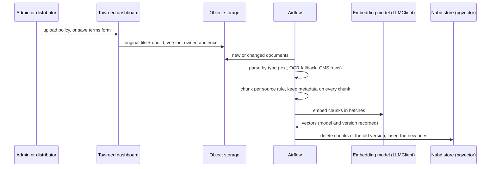
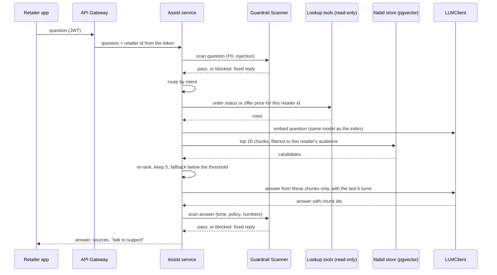

# Nabd Assist: retailer questions answered from Tawreed's documents

**Session 4 · RAG chatbot · Ismail Mohamed · 2026-11-26** ·
Decision: [ADR-0006](../adr/0006-rag-chatbot.md)

## 1. Use case

A retailer taps a push about an offer and asks a question before ordering: "Does this
distributor deliver to Tanta on Thursdays?", "What is the minimum order?", "Can I return a
damaged carton?", "Where is my order from yesterday?". Assist answers inside the Tawreed app, in
Egyptian Arabic, from Tawreed's own documents and data. When it can't answer, it says so and
hands the conversation to support.

It ties to two goals: G2 (relevance and trust, measured by CSAT) and G3 (cost: fewer repeated
calls to the support line).

**In scope for v1:** questions in the retailer app; read-only lookups of the retailer's own
orders and of approved offers; handoff to support.
**Out of scope for v1:** placing or changing orders from the chat, WhatsApp, distributor-side
chat, voice.

## 2. Sources

Ask what each document actually is before choosing how to read it. Data that Tawreed owns in a
database is looked up, not ingested.

| Source | Owner | Format | How it is read | Refreshed |
| --- | --- | --- | --- | --- |
| Return, refund and delivery policies | Tawreed operations and legal | Word and text PDFs | Text extraction | When the admin uploads a new version |
| Distributor terms (minimum order, delivery days, credit) | Each distributor | Often scanned PDFs | Collected through a form in the distributor dashboard; OCR only as a fallback | When the distributor saves the form |
| Help-center articles | Tawreed support | Pages in Tawreed's CMS | Read from the CMS database, not crawled | On publish, through CDC |
| Order status, offer prices, stock | Tawreed backend | Database rows | Not ingested: a read-only lookup at question time | Live |

Arabic OCR is still unreliable, so distributor terms come in as structured fields wherever
possible. A scanned PDF is accepted, but its extracted text goes to the distributor for a
one-time check before it is indexed.

## 3. Ingestion flow

Started by an admin or a distributor, never by a retailer, so nobody waits on it.

Parsing and chunking contain no model. The only model call is the embedding step.

**Chunking per source.** There is no single rule; each source gets the cut that matches its shape.

| Source | Cut | Why |
| --- | --- | --- |
| Policies | By section heading, about 400 tokens, 50 overlap | Answers sit inside one section |
| Distributor terms | One chunk per distributor and topic (delivery, minimum order, credit) | The form already separates them |
| Help-center articles | One chunk per article, or per subheading if long | Articles are short and single-topic |

Every chunk carries: document id, version, owner, audience (all retailers, or the governorates a
distributor serves), and the section title. The audience field is what the access filter in
section 4 reads.

## 4. Question flow

The diagram shows every branch at once. Each message takes one of them:

| Intent | Path | Model calls |
| --- | --- | --- |
| Greeting or small talk | Fixed reply: "I'm Tawreed's assistant for orders, offers and policies" | None |
| Order status, price, stock | Lookup tool, answer from a template with slots (P1) | Intent and guard only |
| Policy or terms question | Retrieval, re-rank, generate | Full path |
| Complaint, legal threat, payment dispute | Handoff to support with the transcript | Intent and guard only |
| Anything else | Fixed reply, offer support | Intent and guard only |

**Security choices.**
- The lookup tools are read-only and take the retailer id from the session token, never from
  the model's output. A prompt that says "show me order 5531" can only ever see the asking
  retailer's own orders. This closes the tool-breach path.
- The access filter runs inside the similarity query (`WHERE audience ...`), before ranking, so
  another distributor's terms are never retrieved, not just hidden afterwards.
- The model is told to answer only from the retrieved chunks and to say it doesn't know
  otherwise. Prices in a generated answer must match a lookup or a chunk; the scan rejects any
  other number.

## 5. The harness

The same Guardrail Scanner as campaign drafts ([ADR-0005](../adr/0005-guardrail-scanning.md)),
with one more rule set for conversations.

| Rule set | Examples |
| --- | --- |
| Security | Prompt injection in the question, requests to act on other accounts, attempts to reach tools that don't exist |
| Data and compliance | No phone numbers, names or addresses in answers; no card or bank details, even if a document contains them (PDPL) |
| Company rules | Egyptian Arabic, friendly and short; no promises about delivery dates beyond what the terms say; no talk about competitors, politics or religion |

## 6. Tunable values

Stored with the other tunable values (SDD section 11), changed without a deployment, and set by
running the evaluation set, not by guessing.

| Value | Start | Notes |
| --- | --- | --- |
| Chunk size and overlap | 400 tokens, 50 | Per source (section 3) |
| Retrieved candidates (K) | 20 | Too few misses the answer; too many buries it |
| Kept after re-ranking | 5 | What the model sees |
| Re-rank score threshold | Set from the eval set | Below it: fallback to the best article and support |
| Conversation turns sent | Last 6 | Enough for "and the second one?" |
| Guard timeout | 2 s per scan | A timeout counts as a block |

## 7. Latency budget (p95)

| Step | Budget |
| --- | --- |
| Gateway and routing | 100 ms |
| Guard scan, question | 400 ms |
| Intent detection | 300 ms |
| Embed question and search | 150 ms |
| Re-rank | 250 ms |
| Generate (short answer, up to about 120 words) | 3.5 s |
| Guard scan, answer | 600 ms |
| **Total** | **about 5.3 s, target 6 s** |

The app shows a typing indicator. The answer is not streamed, because it is scanned before the
retailer sees it.

## 8. Rollout and measurement

- 90% of retailers get Assist; 10% keep the current support path (P4).
- Measured weekly: share of questions answered without handoff, CSAT on answered chats,
  support calls per 1,000 active retailers, and the fallback rate.
- Unanswered questions are reviewed every week. Most fixes are a missing or outdated document,
  not a model change.

## 9. Left for Session 5

Evaluation (the question set, faithfulness and retrieval scores), context engineering, and
observability for the chat path; then drawing Assist as containers in the deployment view.
